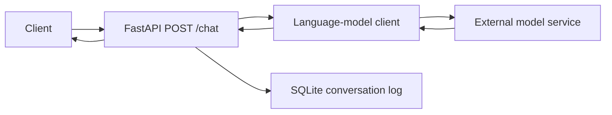

# AI Assistant API

A Python API prototype that accepts a message, requests a response from a language model, and logs the exchange in SQLite. It explores a small application flow using FastAPI, LangChain, and SQLAlchemy.

**Status:** API prototype. Dependency compatibility, error handling, and container startup still need verification.

## Current implementation

- `POST /chat` with request and response schemas.
- A model call through the client in `app/agent.py`.
- SQLite storage for the input and reply.
- FastAPI's interactive API documentation.

Each model request currently contains only the new user message. Stored conversations are not sent back to the model, so the current implementation is stateless from the model's perspective. Tool use, document retrieval, and a multi-step agent workflow are not implemented.

## Project structure

```text
app/
  main.py     # API route and schemas
  agent.py    # Language-model request
  db.py       # Conversation storage
Dockerfile
docker-compose.yml
requirements.txt
.env.example
```

## Local development

From the repository root:

```powershell
python -m venv .venv
.\.venv\Scripts\python.exe -m pip install -r requirements.txt
```

The code reads `OPENAI_API_KEY` from the process environment. Set it before starting the server. One PowerShell option that avoids putting the key literally into command history is:

```powershell
$apiKeyInput = Read-Host "API key" -AsSecureString
$env:OPENAI_API_KEY = [System.Net.NetworkCredential]::new('', $apiKeyInput).Password
.\.venv\Scripts\python.exe -m uvicorn app.main:app --reload
```

Keep this terminal open while using the local server. Copying `.env.example` to `.env` alone does not load variables into this Python process; the current application does not load dotenv files itself.

Open `http://127.0.0.1:8000/docs` to inspect and try the endpoint. Requests use the configured external model service and may incur charges. A valid key and access to the model configured in `app/agent.py` are required.

The module path above matches the relative imports in the current code. A full launch and live model request have not yet been verified against a fresh dependency installation.

## Request and response

Request shape:

```http
POST /chat
Content-Type: application/json

{"message": "Explain the difference between a list and a tuple in Python."}
```

Response shape:

```json
{"reply": "Model-generated text"}
```

The response above illustrates the schema; it is not a saved model output.

PowerShell example after the server starts:

```powershell
$requestBody = @{ message = 'Explain a Python list in one sentence.' } | ConvertTo-Json
Invoke-RestMethod -Method Post -Uri 'http://127.0.0.1:8000/chat' -ContentType 'application/json' -Body $requestBody
```

## Request flow



## Configuration and repository hygiene

`.env.example` documents the expected variable for local configuration and the existing Compose file. Keep actual keys in your environment or an ignored `.env` file. Runtime databases, virtual environments, and Python caches should stay outside version control. Adding `.gitignore` does not remove files already tracked by Git.

The existing Docker startup copies the contents of `app/` to the container root and imports `main` as a top-level module. This conflicts with the application's relative imports. The container workflow needs to preserve the `app` package and import `app.main:app` before it is advertised as working. See [ROADMAP.md](ROADMAP.md).

The current API also exposes internal exception messages and has no implemented authentication or rate limits. These need attention before a shared public deployment.

## Next steps

Improve request validation and error handling, verify dependencies, fix container startup, and add API tests using a simulated model response. Then choose whether the product should remain a stateless chat API or support isolated conversation sessions.

See [ROADMAP.md](ROADMAP.md) for completion criteria.

Built by [Roxana Khaleghi](https://github.com/roxanakhaleghi67).

---

## فارسی

FastAPI + LangChain + Docker

### ویژگی‌ها
- Endpoint رست برای چت
- ایجنت LangChain با OpenAI
- ثبت مکالمات در پایگاه داده SQLite
- آماده اجرا با Docker

### روش اجرا
1. کلون کنید و در پوشه پروژه `.env` بسازید:
OPENAI_API_KEY=کلید خودتان
2. اجرا با داکر کامپوز:
docker-compose up --build
3. مستندات و تست API:
http://localhost:8000/docs


---

## License
MIT

