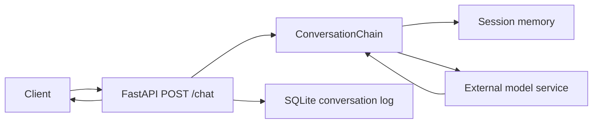

# AI Assistant API

A small FastAPI service that sends a user message to an OpenAI chat model through LangChain,
keeps a per-session conversation memory, and logs each exchange in SQLite.

**Status:** working prototype. The API starts and answers `GET /health` without a key; a real
`POST /chat` needs `OPENAI_API_KEY`. Automated tests are not included yet.

## Endpoints

| Method | Path | Purpose |
| --- | --- | --- |
| `GET` | `/health` | Liveness probe; returns `{"status": "ok"}` without touching the model |
| `POST` | `/chat` | Sends a message and returns the model reply, using the session memory |
| `GET` | `/docs` | Interactive API documentation (Swagger UI) |

## Current implementation

- `POST /chat` accepts `message` and an optional `session_id` (default `"default"`).
- `app/agent.py` builds a `ConversationChain` with a `ConversationBufferMemory` **per session**,
  so the model sees the earlier turns of that session.
- The model client is created lazily, so importing the application never requires a key and
  never performs network access.
- Each exchange is stored in SQLite through SQLAlchemy (`app/db.py`).
- `python-dotenv` is used when it is installed; otherwise the process environment is used.

Memory lives in the process and is lost on restart. The SQLite table stores the exchanges but
has no session-id column, so this version cannot rebuild a session from the database. Tool use,
document retrieval, and a multi-step agent workflow are not implemented.

## Project structure

```text
app/
  main.py      # FastAPI application: /chat, /health
  agent.py     # lazy model client and per-session conversation memory
  schemas.py   # request and response models
  db.py        # SQLite storage
Dockerfile
docker-compose.yml
requirements.txt
.env.example
```

## Local development

From the repository root:

```powershell
python -m venv .venv
.\.venv\Scripts\python.exe -m pip install -r requirements.txt
```

Set the key in the environment, or copy `.env.example` to `.env` (the app loads `.env` when
`python-dotenv` is installed):

```powershell
$apiKeyInput = Read-Host "API key" -AsSecureString
$env:OPENAI_API_KEY = [System.Net.NetworkCredential]::new('', $apiKeyInput).Password
.\.venv\Scripts\python.exe -m uvicorn app.main:app --reload
```

Open `http://127.0.0.1:8000/docs` to try the endpoints. Requests call an external model service
and may incur charges.

## Docker

The image imports the application as a package (`app.main:app`), which matches the relative
imports in the code.

```bash
docker compose up --build
```

or manually:

```bash
docker build -t my-ai .
docker run -p 8000:8000 -e OPENAI_API_KEY="..." my-ai
```

## Request and response

```http
POST /chat
Content-Type: application/json

{"message": "Explain the difference between a list and a tuple in Python.", "session_id": "alice"}
```

```json
{"reply": "Model-generated text"}
```

The reply above only illustrates the schema; it is not a saved model output.

```powershell
$body = @{ message = 'Explain a Python list in one sentence.'; session_id = 'demo' } | ConvertTo-Json
Invoke-RestMethod -Method Post -Uri 'http://127.0.0.1:8000/chat' -ContentType 'application/json' -Body $body
Invoke-RestMethod -Method Get -Uri 'http://127.0.0.1:8000/health'
```

## Request flow



## Configuration and security

- `.env` is ignored by git; keep real keys there or in the process environment.
- Internal exception messages are currently returned to the client, and there is no
  authentication or rate limiting. Both are needed before a shared public deployment.

## Next steps

- Add tests for `/health`, `/chat` and the storage layer with a simulated model response.
- Store the session id with each exchange so a session can be rebuilt after a restart.
- Replace the deprecated `langchain_community.ChatOpenAI` import with `langchain_openai.ChatOpenAI`.

Built by [Roxana Khaleghi](https://github.com/roxanakhaleghi67).

---

## فارسی

سرویس FastAPI + LangChain + SQLite برای چت با مدل زبانی، با حافظهٔ گفتگو برای هر نشست.

### ویژگی‌ها
- endpoint چت (`POST /chat`) با `message` و `session_id` اختیاری
- حافظهٔ گفتگو برای هر نشست (`ConversationChain` + `ConversationBufferMemory`)
- endpoint سلامت (`GET /health`) که بدون کلید هم پاسخ می‌دهد
- ثبت مکالمات در SQLite
- آمادهٔ اجرا با Docker (ایمپورت به‌صورت `app.main:app`)

### روش اجرا
1. نصب وابستگی‌ها:
```powershell
python -m venv .venv
.\.venv\Scripts\python.exe -m pip install -r requirements.txt
```
2. کلید را در محیط یا فایل `.env` بگذارید:
```
OPENAI_API_KEY=کلید-شما
```
3. اجرا:
```powershell
.\.venv\Scripts\python.exe -m uvicorn app.main:app --reload
```
4. مستندات و آزمون API: `http://127.0.0.1:8000/docs`

### با داکر
```bash
docker compose up --build
```

حافظهٔ گفتگو داخل فرایند نگه داشته می‌شود و با ری‌استارت پاک می‌شود؛ جدول SQLite فعلاً ستون
`session_id` ندارد.

## License

MIT